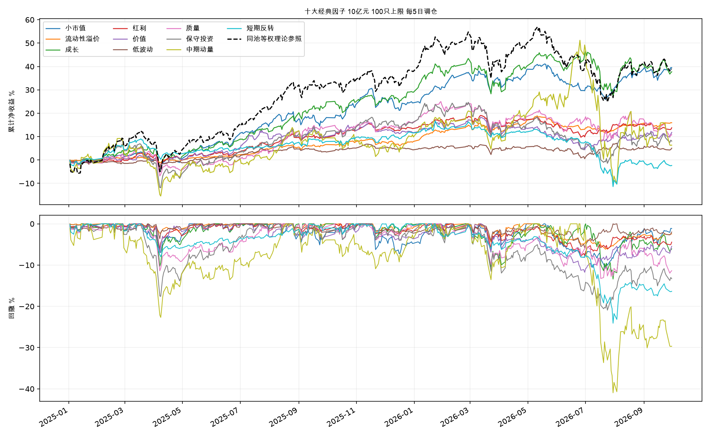

# A 股十大经典因子研究

统一评估价值、小市值、中期动量、短期反转、低波动、质量、成长、红利、流动性溢价和保守投资。研究期间为 **2025-01-02 至 2026-09-30**，共 424 个交易日；初始资金 10 亿元，最多 100 只股票，95% 目标仓位，每 5 个交易日调仓。

小市值在本样本的扣费后夏普排名首位：区间净收益 **39.48%**，最大回撤 **10.84%**，夏普 **1.670**，平均实际仓位 **42.86%**。本研究采用免费公开数据的保守探索性口径，完整解释见主报告。

## 1. 报告入口

- [完整主报告](reports/classic-factors/report.md)：净收益、Rank IC、理论分组、因子相关性、覆盖、成交容量、分期结果及完整来源。
- [完整指标 CSV](reports/classic-factors/comparison.csv)、[逐日净值](reports/classic-factors/equity.csv)、[财务与请求来源索引](reports/classic-factors/sources.json)。
- [研究核验](reports/classic-factors/validation.json)、[报告核验](reports/classic-factors/artifact_validation.json)、[本次发布测试](validation/classic-factors-tests.xml)。
- [文件校验清单](PUBLICATION-MANIFEST.json)、[发布转换与原始文件哈希](validation/publication-lineage.json)、[第三方来源与许可](THIRD_PARTY_NOTICES.md)。



<a id="factor-reports"></a>

## 2. 单因子报告目录

| 因子 | 单因子报告 | 运行配置 | 精确指标 |
|---|---|---|---|
| 小市值 | [报告](runs/classic-size-af58780c97/report.md) | [配置](runs/classic-size-af58780c97/config.json) | [精确指标](runs/classic-size-af58780c97/summary.json) |
| 流动性溢价 | [报告](runs/classic-liquidity-af58780c97/report.md) | [配置](runs/classic-liquidity-af58780c97/config.json) | [精确指标](runs/classic-liquidity-af58780c97/summary.json) |
| 成长 | [报告](runs/classic-growth-af58780c97/report.md) | [配置](runs/classic-growth-af58780c97/config.json) | [精确指标](runs/classic-growth-af58780c97/summary.json) |
| 红利 | [报告](runs/classic-dividend-af58780c97/report.md) | [配置](runs/classic-dividend-af58780c97/config.json) | [精确指标](runs/classic-dividend-af58780c97/summary.json) |
| 价值 | [报告](runs/classic-value-af58780c97/report.md) | [配置](runs/classic-value-af58780c97/config.json) | [精确指标](runs/classic-value-af58780c97/summary.json) |
| 低波动 | [报告](runs/classic-low-volatility-af58780c97/report.md) | [配置](runs/classic-low-volatility-af58780c97/config.json) | [精确指标](runs/classic-low-volatility-af58780c97/summary.json) |
| 质量 | [报告](runs/classic-quality-af58780c97/report.md) | [配置](runs/classic-quality-af58780c97/config.json) | [精确指标](runs/classic-quality-af58780c97/summary.json) |
| 保守投资 | [报告](runs/classic-investment-af58780c97/report.md) | [配置](runs/classic-investment-af58780c97/config.json) | [精确指标](runs/classic-investment-af58780c97/summary.json) |
| 中期动量 | [报告](runs/classic-momentum-af58780c97/report.md) | [配置](runs/classic-momentum-af58780c97/config.json) | [精确指标](runs/classic-momentum-af58780c97/summary.json) |
| 短期反转 | [报告](runs/classic-reversal-af58780c97/report.md) | [配置](runs/classic-reversal-af58780c97/config.json) | [精确指标](runs/classic-reversal-af58780c97/summary.json) |

每个运行目录发布订单、成交、账簿、净值、持仓、费用和退出记录七类 Parquet 表，以及退出摘要、源码快照、设备与输入指纹。完整本地执行还生成逐日选股与事件诊断缓存；重新运行研究可生成这些文件。

## 3. 数据来源与时间口径

| 数据 | 来源与实际字段 |
|---|---|
| 行情、成交、复权 | [课程 Release data-backtest-20261016](https://github.com/aslan9/pku_quantllm/releases/tag/data-backtest-20261016) 的 open、high、low、close、amt、num_trades、cumadj 七个 Feather 矩阵；底层行情供应商以课程发布说明为溯源边界 |
| 股本 | [东方财富数据接口](https://datacenter-web.eastmoney.com/api/data/v1/get)，RPT_VALUEANALYSIS_DET / TOTAL_SHARES；市值由本地原始收盘价乘股本计算 |
| 资产负债表 | RPT_F10_FINANCE_GBALANCE、BBALANCE、IBALANCE、SBALANCE；TOTAL_ASSETS、TOTAL_PARENT_EQUITY |
| 利润表 | RPT_F10_FINANCE_GINCOME；TOTAL_OPERATE_INCOME（营业总收入）、PARENT_NETPROFIT |
| 已实施分红 | RPT_SHAREBONUS_DET；ASSIGN_PROGRESS、PRETAX_BONUS_RMB、TOTAL_SHARES、EX_DIVIDEND_DATE、NOTICE_DATE 等 |
| 历史 ST 状态 | BaoStock 0.9.4 / query_daily_history_k_AStock 的 isST；按当日开盘前可知推定 |

行情压缩包发布 SHA-256：`5766950f2a105244867b842709cf4bad890e4e11df0eebeeaa4fec42dc05803d`。行情实际加载 2023-01-03 至 2026-09-30，研究前数据用于预热。

东方财富抓取时间为 **2026-10-27 11:42:46 至 12:04:27（Asia/Seoul，UTC+09:00）**，536 组查询、1,469 页响应；财报期为 2021-03-31 至 2026-06-30。请求 URL、参数、时间、原始缓存相对路径与哈希见来源索引。行情、财务响应、归一化特征及状态原始缓存按来源说明准备，数据文件的原始哈希保留在已发布记录中。

财务记录自 max(REPORT_DATE, NOTICE_DATE, UPDATE_DATE) 日期结束后的下一交易日进入信号。当前快照与时间推迟构成历史版本近似，严格历史时点研究需要完整修订记录。财务计算采用结构化资产负债表和利润表；现金流量表未参与计算，公司原始财报 PDF 未逐份提取校对。共同股票池筛选、信息滞后、日线开盘成交、容量及费用假设均影响结果。主报告第 3、4、6 节提供全部字段、时间范围、交易规则与因子定义参考。

## 4. 安装与结果核验

使用 Apple Silicon Mac、Python 3.11 和可用的 Apple MPS。批量因子计算使用 MPS，金额与费用使用 Decimal。先在仓库根目录执行：

```bash
python3.11 -m venv .venv
.venv/bin/python -m pip install -e '.[dev]'
.venv/bin/python -c "import torch; assert torch.backends.mps.is_available(); print(torch.__version__, 'MPS available')"
.venv/bin/python tools/check_publication.py
.venv/bin/python -m pytest --junitxml=validation/classic-factors-tests.xml
.venv/bin/python tools/check_factor_study.py
```

文件校验以原始克隆内容为基准；本地测试或报告重建会更新验收时间及部分文件哈希，可在执行这些命令之前单独运行 `tools/check_publication.py`。

研究原始验证已对 10 项策略逐一重放七类表；`validation.json` 保存这次完整重放的证据。本次发布副本另行运行测试和报告数据核验。研究指纹为 `5a440907474e21fec54081d57d7e72e779bbc5de99c5dfc576edf48fe9b10ea7`。

## 5. 数据准备与完整重算

建议使用独立克隆副本，例如 `factor-search-reproduce`。先按课程 Release 下载并核对压缩包哈希，将七个 Feather 文件放入根目录 `feathers/`。再运行：

```bash
.venv/bin/python tools/prepare_status.py
.venv/bin/python tools/run_factor_study.py --config configs/classic_factors.toml --prepare-only
```

首条命令取得历史 ST 状态，第二条命令取得并校验东方财富财务、股本和分红响应。已有匹配的冻结缓存可按来源索引中的相对路径放置。公开接口的后续更新可能改变覆盖、因子值和运行指纹，精确重现历史数值要求全部原始输入哈希一致。

将已发布的结果目录成对移入基准目录，保留其内部相对链接，然后生成新结果并逐表重放：

```bash
mkdir baseline
mv reports runs baseline/
.venv/bin/python tools/run_factor_study.py --config configs/classic_factors.toml --verify-replay
.venv/bin/python tools/check_factor_study.py
```

配置采用收盘决策、次日开盘复核、T+1、历史数量与涨跌幅规则、先卖后买；单证券共享容量为决策日成交额与此前 20 日均成交额较小值的 1%。末日按 strict_end 尝试退出，剩余持仓按有效行情估值。配置文件列明佣金、最低佣金、滑点、印花税及容量参数。

## 6. 报告重建与发布指纹

仅使用已发布净值、成交和诊断表即可重建报告与图表：

```bash
.venv/bin/python tools/run_factor_study.py --config configs/classic_factors.toml --report-only
.venv/bin/python tools/check_factor_study.py
```

原始运行指纹、输入数据哈希及源码快照哈希描述研究执行时的材料；发布校验清单描述仓库中的文件。发布过程将本机工作区绝对路径转换为相对路径、将测试主机名统一为 `apple-silicon-mps`，并刷新受影响的文件校验清单。原始文件哈希与转换范围见发布转换记录。收益、费用、持仓、配置参数和原始输入指纹沿用本次研究结果。
