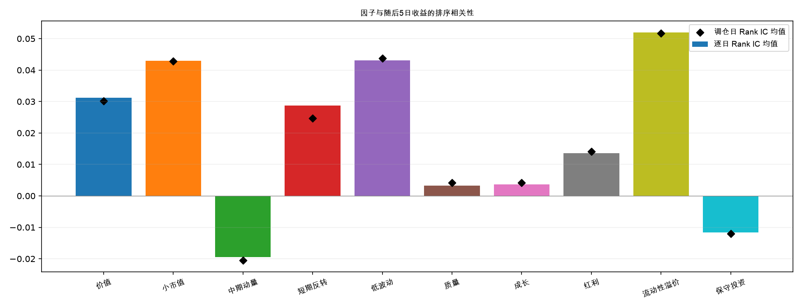
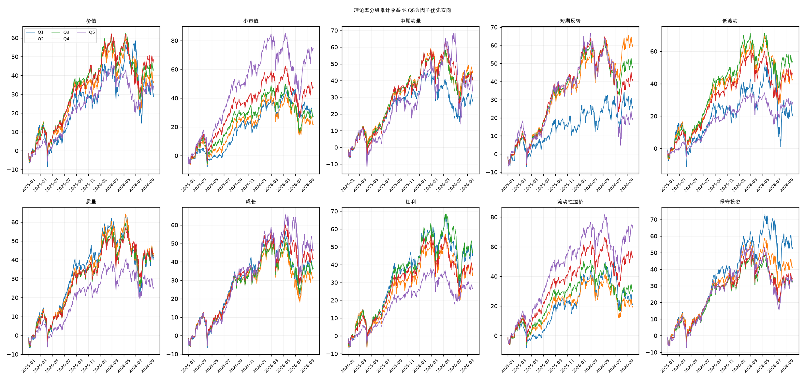
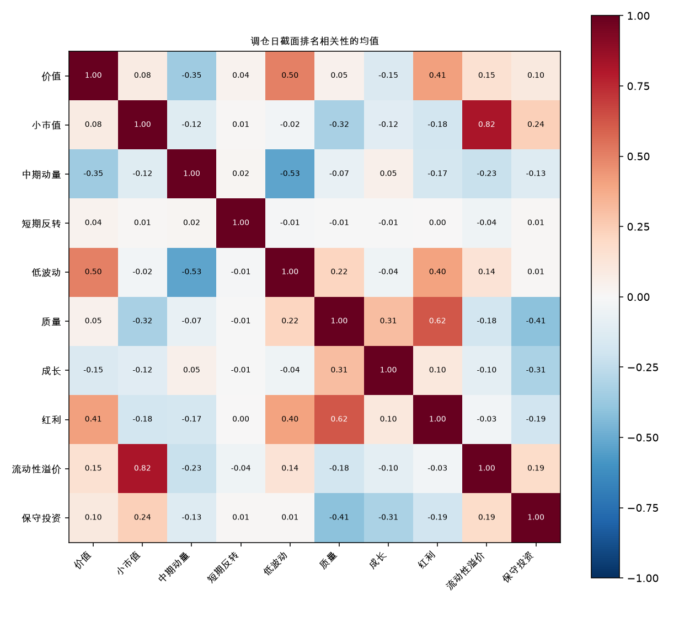
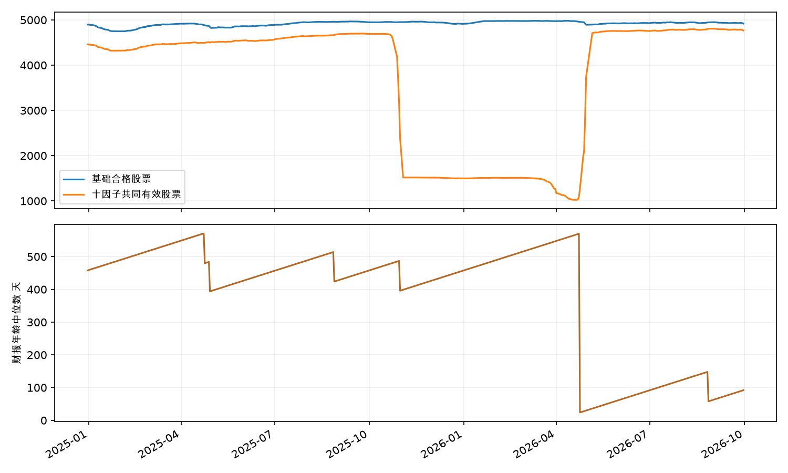

# A股十大经典因子策略评估

2025-01-02 至 2026-09-30，424 个交易日。初始资金 10 亿元，最多 100 只股票，95% 目标仓位，每 5 个交易日调仓。

按扣费后夏普排序，小市值位居本样本首位，区间净收益 39.48%，最大回撤 10.84%，夏普 1.670。平均实际仓位为 42.86%，应结合下表中的容量和成本阅读。

本研究采用免费公开数据的保守探索性口径。财务记录按公告与更新日期中的较晚日期推迟使用，结果同时受到信息滞后、共同样本筛选及日线成交假设的影响。

## 1 策略净表现

净收益已计入账户交易费用。年化指标按每年 252 个交易日折算；夏普采用零无风险利率，以日收益均值除以日收益样本标准差后年化。Calmar 为年化收益除以最大回撤，完整指标表同时保留年化波动率和换手率。

| 排名 | 因子 | 区间净收益 | 年化净收益 | 最大回撤 | 夏普 | 平均仓位 | 交易成本 万元 |
|---:|---|---:|---:|---:|---:|---:|---:|
| 1 | 小市值 | 39.48% | 21.87% | 10.84% | 1.670 | 42.86% | 361.89 |
| 2 | 流动性溢价 | 15.92% | 9.18% | 6.17% | 1.522 | 20.42% | 323.63 |
| 3 | 成长 | 37.72% | 20.95% | 13.40% | 1.198 | 65.11% | 811.10 |
| 4 | 红利 | 13.77% | 7.97% | 7.83% | 0.874 | 60.30% | 620.95 |
| 5 | 价值 | 11.77% | 6.83% | 11.76% | 0.637 | 66.76% | 554.38 |
| 6 | 低波动 | 5.02% | 2.95% | 5.84% | 0.473 | 53.15% | 717.62 |
| 7 | 质量 | 10.78% | 6.27% | 13.26% | 0.466 | 73.85% | 717.58 |
| 8 | 保守投资 | 8.07% | 4.72% | 20.93% | 0.340 | 66.97% | 641.47 |
| 9 | 中期动量 | 6.34% | 3.72% | 40.96% | 0.277 | 77.94% | 1,574.74 |
| 10 | 短期反转 | -2.36% | -1.41% | 24.10% | -0.055 | 28.77% | 3,483.84 |

共同股票池等权理论参照的区间收益为 38.82%。参照每 5 日重配、95% 目标股票仓位，采用零费用、分数份额及充足容量假设；策略表反映实际账户的费用和成交限制。

## 2 因子选股能力

Rank IC 是因子排序与随后 5 日收益排序的相关性。全部指标已统一为分数越高越优先；正 IC 表示优先方向与随后收益一致。标签从次日开盘到第六日开盘，最后 6 个决策日的完整标签留空。逐日标签相互重叠，调仓日统计提供对应的五日节奏参照。ICIR 为均值除以标准差。

| 因子 | Rank IC 均值 | 调仓日 IC 均值 | ICIR | 正 IC 比例 | 理论 Q5收益 | 理论 Q1收益 |
|---|---:|---:|---:|---:|---:|---:|
| 小市值 | 0.043 | 0.043 | 0.250 | 60.38% | 74.04% | 27.52% |
| 流动性溢价 | 0.052 | 0.052 | 0.341 | 64.20% | 73.89% | 21.08% |
| 成长 | 0.004 | 0.004 | 0.041 | 51.79% | 46.15% | 37.27% |
| 红利 | 0.014 | 0.014 | 0.095 | 55.13% | 27.74% | 46.02% |
| 价值 | 0.031 | 0.030 | 0.163 | 53.70% | 34.43% | 28.85% |
| 低波动 | 0.043 | 0.044 | 0.177 | 59.19% | 28.61% | 20.05% |
| 质量 | 0.003 | 0.004 | 0.030 | 53.70% | 25.35% | 41.11% |
| 保守投资 | -0.012 | -0.012 | -0.112 | 46.06% | 33.06% | 52.31% |
| 中期动量 | -0.020 | -0.021 | -0.109 | 46.54% | 32.78% | 29.13% |
| 短期反转 | 0.029 | 0.025 | 0.198 | 58.23% | 19.72% | 25.88% |

流动性溢价的逐日 Rank IC 均值为 0.052，其理论 Q5 区间收益为 73.89%，实际账户区间净收益为 15.92%，平均实际仓位为 20.42%。理论分组与实际组合的证券数量、费用和容量条件不同，这些差异应一并用于理解收益。

Q1 至 Q5 在当日共同股票池内按指标分成五组，Q5 为优先方向。分组曲线使用全部入组证券和理论等权配置，显示因子排序效果；Q5 与 Q1 的差值属于研究诊断。报价中断期间延续持仓及最近有效估值。

## 3 数据来源与覆盖

### 3.1 实际数据来源

本次回测使用课程公开行情包、东方财富和 BaoStock 三个外部数据渠道。证券范围和实际交易日期由行情矩阵的列与日期行确定。

| 数据类别 | 发布方与接口 | 本次使用内容 |
|---|---|---|
| 日行情、成交与复权 | [课程数据 Release data-backtest-20261016](https://github.com/aslan9/pku_quantllm/releases/tag/data-backtest-20261016) | open、high、low、close、amt、num_trades、cumadj 七个 Feather 矩阵；原始价格用于成交，累计复权因子用于信号与持仓总收益核算 |
| 历史总股本 | 东方财富 RPT_VALUEANALYSIS_DET | TOTAL_SHARES；总市值按本地原始收盘价 × 当日总股本计算；CLOSE_PRICE 用于交叉核对，TOTAL_MARKET_CAP 随响应留存 |
| 一般企业资产负债表 | 东方财富 RPT_F10_FINANCE_GBALANCE | TOTAL_ASSETS 总资产、TOTAL_PARENT_EQUITY 归母净资产 |
| 银行资产负债表 | 东方财富 RPT_F10_FINANCE_BBALANCE | TOTAL_ASSETS、TOTAL_PARENT_EQUITY |
| 保险资产负债表 | 东方财富 RPT_F10_FINANCE_IBALANCE | TOTAL_ASSETS、TOTAL_PARENT_EQUITY |
| 证券公司资产负债表 | 东方财富 RPT_F10_FINANCE_SBALANCE | TOTAL_ASSETS、TOTAL_PARENT_EQUITY |
| 利润表 | 东方财富 RPT_F10_FINANCE_GINCOME | TOTAL_OPERATE_INCOME 营业总收入、PARENT_NETPROFIT 归母净利润 |
| 已实施现金分红 | 东方财富 RPT_SHAREBONUS_DET | ASSIGN_PROGRESS、PRETAX_BONUS_RMB、TOTAL_SHARES、EX_DIVIDEND_DATE、NOTICE_DATE；有更新日期时一并参与可用时间判断 |
| 历史 ST 状态 | BaoStock 0.9.4 / query_daily_history_k_AStock | 使用既有逐日缓存的 isST；原始快照同时保留 tradestatus 等返回字段 |

东方财富统一请求入口为[数据接口](https://datacenter-web.eastmoney.com/api/data/v1/get)。财报响应同时保留 SECUCODE、REPORT_DATE、NOTICE_DATE、UPDATE_DATE 和 CURRENCY。本次抓取于 2026-10-27 11:42:46 至 2026-10-27 12:04:27（Asia/Seoul，UTC+09:00），共 536 组查询、1,469 页响应。[sources.json](sources.json)逐项记录接口名称、筛选参数、请求 URL、抓取时间、原始响应路径与 SHA-256；原始响应保存在 data/classic_factors/raw。

### 3.2 数据时间范围与溯源边界

| 数据 | 本次范围与用途 |
|---|---|
| 行情包完整范围 | 2020-01-02 至 2026-10-16，1,643 个交易日 × 5,451 列证券 |
| 行情实际加载 | 2023-01-03 至 2026-09-30，908 日 × 5,451 列；研究起点之前用于预热；股票范围 5,450 列 |
| 历史股本与 ST 状态 | 2024-12-31 至 2026-09-30，425 个决策及交易日 |
| 财务报告期 | 2021-03-31 至 2026-06-30，22 个季度报告期；匹配本地证券后保留 230,710 条记录 |
| 分红事件查询 | 除权除息日 2023-12-31 至 2026-09-30；因子使用滚动 365 日窗口 |

行情包 feathers.zip 的发布 SHA-256 为 `5766950f2a105244867b842709cf4bad890e4e11df0eebeeaa4fec42dc05803d`。本地七个输入文件的逐文件哈希、加载区间和维度见[行情输入清单](../../runs/classic-size-af58780c97/data_profile.json)。行情可追溯到课程 Release；该发布说明没有披露其底层行情供应商。历史 ST 缓存位于 data/status/daily，逐日状态按当日开盘前可知推定，覆盖证据见[验收记录](validation.json)。

### 3.3 财报字段与历史版本口径

财务数据采用东方财富整理的结构化报表字段，币种限定为 CNY，金额按人民币元读取。本次财务因子使用资产负债表与利润表；现金流量表未参与计算，上市公司原始财报 PDF 未逐份提取校对。价值使用归母净资产；质量使用归母净利润 TTM 与对应报告期及上年同期平均归母净资产；成长定义中的营业收入对应原始字段 TOTAL_OPERATE_INCOME，即营业总收入；保守投资使用总资产同比。

每条财务记录从 max(REPORT_DATE, NOTICE_DATE, UPDATE_DATE) 日期结束后的下一交易日开始进入信号。财报按报告期维护各自可用记录，较早报告期的晚修订保留在其自身期间。TTM 按当期累计值加上年全年值、再减上年同期累计值计算；年报直接使用全年值。归一化明细保存在 data/classic_factors/financial_records.parquet，source_key 可关联原始请求索引。

本研究使用当前抓取版本加保守时间推迟的近似，并非完整历史时点数据库。源更新时间不能还原全部历史修订过程，后续重算或修订可能改变历史覆盖。当前行情矩阵的证券范围也可能存在覆盖选择偏差，因此结果适用于本次冻结数据及共同有效样本；长期有效性仍需更长区间和更完整的历史版本证据。

### 3.4 数据覆盖与滞后

基础合格股票日均 4,922 只，十因子共同有效股票日均 3,721 只，范围为 1,024 至 4,807 只。共同有效股票的财报年龄中位数再取日均为 379 天，年龄从对应报告期末计算。

累计读取 230,710 条本地证券财务记录，其中 124,539 条的更新日期晚于原始公告日期。已实施分红事件共 13,198 条，其中 77 条的必要字段待核验，其涉及窗口按缺失处理。每项因子的独立覆盖及共同覆盖逐日保存在 [coverage.csv](coverage.csv)。

## 4 成交规则与容量

收盘产生固定数量委托，次日原始开盘价复核，卖先买后，执行 T+1 和各板块数量规则。指标同分时按证券代码升序。佣金单边万一、每单最低 5 元，卖出印花税万五，独立滑点万五，另计历史过户费。每证券共享容量为决策日成交额与此前 20 日均成交额较小值的 1%；单次开盘结束后余量到期。名额不足时，每只股票仍以 0.95% 为目标，其余资金保留现金。

末日采用 strict_end，在末日开盘按实际规则尝试退出，剩余权益按有效行情估值。选股和退出按逐日信息推进；完整日线的当日成交额用于开盘记录有效性核验，累计复权因子按当日开盘前生效推定。收益采用总收益等价单位，原始价格用于成交和费用。分红用于红利因子的排序指标，总收益等价核算统一处理持仓的公司行动。

| 因子 | 年化单边换手 | 容量到期余量累计 亿元 | 期末股票市值 万元 | 成交笔数 |
|---|---:|---:|---:|---:|
| 小市值 | 1.05 | 493.70 | 59,609.13 | 9,147 |
| 流动性溢价 | 1.04 | 474.22 | 18,702.02 | 9,341 |
| 成长 | 2.26 | 284.21 | 63,591.07 | 9,164 |
| 红利 | 1.99 | 289.22 | 56,360.15 | 9,024 |
| 价值 | 1.80 | 234.93 | 64,068.19 | 9,035 |
| 低波动 | 2.44 | 295.95 | 47,393.76 | 9,326 |
| 质量 | 2.26 | 177.83 | 45,115.37 | 8,914 |
| 保守投资 | 2.07 | 249.92 | 59,532.40 | 9,332 |
| 中期动量 | 4.96 | 119.25 | 22,797.85 | 9,416 |
| 短期反转 | 11.33 | 323.84 | 5,744.46 | 14,831 |

容量到期余量按各次开盘价折算，含跨日重复尝试和买卖双向委托；该累计量用于解释交易约束。年化单边换手等于逐日双边成交额除以前日净资产后的和，再乘以 252/交易日数/2。

交易规则、税费及日历参考以下官方资料。佣金、最低佣金、滑点和成交容量采用[研究配置](config.json)中的参数假设。

- [2025 年交易日历](https://www.sse.com.cn/disclosure/dealinstruc/closed/c/c_20241223_10767110.shtml)
- [2026 年国庆休市](https://www.sse.com.cn/disclosure/announcement/general/c/c_20260915_10832273.shtml)
- [2026-07-06 主板风险警示涨跌幅调整](https://www.sse.com.cn/aboutus/mediacenter/hotandd/c/c_20260424_10816474.shtml)
- [证券交易印花税减半](https://shanxi.chinatax.gov.cn/web/detail/sx-11400-545-1780448)
- [零股卖出规则](https://www.sse.com.cn/lawandrules/guide/stock/jyglywznylc/tz/c/c_20230209_5716007.shtml)
- [上交所股票投资费用说明与过户费](https://one.sse.com.cn/onething/gptz/)
- [中国结算历史收费调整记录](https://m.chinaclear.cn/zdjs/dsj/about_dsj.shtml)

## 5 分期表现

| 因子 | 2025年 | 2026年至9月 |
|---|---:|---:|
| 小市值 | 24.45% | 12.07% |
| 流动性溢价 | 7.92% | 7.42% |
| 成长 | 28.96% | 6.79% |
| 红利 | 13.48% | 0.26% |
| 价值 | 11.67% | 0.08% |
| 低波动 | 4.34% | 0.66% |
| 质量 | 15.99% | -4.49% |
| 保守投资 | 16.24% | -7.03% |
| 中期动量 | 9.83% | -3.17% |
| 短期反转 | 11.56% | -12.48% |

季度收益保存在 [period_returns.csv](period_returns.csv)。窗口、指标和优先方向按固定定义运行，分期结果用于观察本样本的变化。

## 6 因子定义与复现

| 因子 | 指标 | 优先方向 |
|---|---|---|
| 价值 | 最新可用归母净资产 / 当日总市值 | 高 |
| 小市值 | 当日总市值 | 低 |
| 中期动量 | 复权收盘价[t-21] / 复权收盘价[t-252] - 1 | 高 |
| 短期反转 | 最近 5 日复权收益 | 低 |
| 低波动 | 最近 60 日日收益总体标准差 | 低 |
| 质量 | 归母净利润 TTM / 同期及上年同期平均归母净资产 | 高 |
| 成长 | 营业收入 TTM / 上年同期营业收入 TTM - 1 | 高 |
| 红利 | 近 365 日已实施税前现金分红总额 / 当日总市值 | 高 |
| 流动性溢价 | 最近 20 日 mean(abs(日收益) / 成交额) | 高 |
| 保守投资 | 总资产 / 上年同季总资产 - 1 | 低 |

营业收入和归母净利润 TTM 按累计财报计算：当期累计值加上年全年值，再减上年同期累计值；年报直接使用全年值。财报按报告期维护各自版本，较早报告期的晚修订保留在其自身期间。红利以已实施方案的每 10 股税前现金金额乘以方案股本再除以 10 计算，观察窗口为 365 日。

因子选择参考 [MSCI 八类因子体系](https://www.msci.com/research-and-insights/blog-post/creating-a-common-language-for-factor-investing)、[French 因子数据库](https://mba.tuck.dartmouth.edu/pages/faculty/Ken.French/data_library.html)及[投资因子定义](https://mba.tuck.dartmouth.edu/pages/faculty/ken.french/Data_Library/f-f_5_factors_2x3.html)。本研究采用表中可复现的 A 股代表性实现。

因子分类与定义参考上述研究来源。策略收益、IC、回撤、理论五分组和共同股票池等权参照由本项目使用第 3 节所列数据计算；夏普的无风险利率设为零。

研究指纹：`5a440907474e21fec54081d57d7e72e779bbc5de99c5dfc576edf48fe9b10ea7`。因子及行情数值计算设备为 Apple MPS，资金与费用采用 Decimal 记账。

- [完整指标表](comparison.csv)、[逐日净值](equity.csv)、[IC 明细](rank_ic.csv)、[数据审计](data_audit.json)、[验收记录](validation.json)。
- 批量复现：`.venv/bin/python tools/run_factor_study.py --config configs/classic_factors.toml`。
- 完整重放：在批量命令末尾加入 `--verify-replay`，逐个核对订单、成交、账本、净值与持仓。

逐笔运行目录：

- 小市值：[单项报告](../../runs/classic-size-af58780c97/report.md) · [运行配置](../../runs/classic-size-af58780c97/config.json) · [精确指标](../../runs/classic-size-af58780c97/summary.json)。
- 流动性溢价：[单项报告](../../runs/classic-liquidity-af58780c97/report.md) · [运行配置](../../runs/classic-liquidity-af58780c97/config.json) · [精确指标](../../runs/classic-liquidity-af58780c97/summary.json)。
- 成长：[单项报告](../../runs/classic-growth-af58780c97/report.md) · [运行配置](../../runs/classic-growth-af58780c97/config.json) · [精确指标](../../runs/classic-growth-af58780c97/summary.json)。
- 红利：[单项报告](../../runs/classic-dividend-af58780c97/report.md) · [运行配置](../../runs/classic-dividend-af58780c97/config.json) · [精确指标](../../runs/classic-dividend-af58780c97/summary.json)。
- 价值：[单项报告](../../runs/classic-value-af58780c97/report.md) · [运行配置](../../runs/classic-value-af58780c97/config.json) · [精确指标](../../runs/classic-value-af58780c97/summary.json)。
- 低波动：[单项报告](../../runs/classic-low-volatility-af58780c97/report.md) · [运行配置](../../runs/classic-low-volatility-af58780c97/config.json) · [精确指标](../../runs/classic-low-volatility-af58780c97/summary.json)。
- 质量：[单项报告](../../runs/classic-quality-af58780c97/report.md) · [运行配置](../../runs/classic-quality-af58780c97/config.json) · [精确指标](../../runs/classic-quality-af58780c97/summary.json)。
- 保守投资：[单项报告](../../runs/classic-investment-af58780c97/report.md) · [运行配置](../../runs/classic-investment-af58780c97/config.json) · [精确指标](../../runs/classic-investment-af58780c97/summary.json)。
- 中期动量：[单项报告](../../runs/classic-momentum-af58780c97/report.md) · [运行配置](../../runs/classic-momentum-af58780c97/config.json) · [精确指标](../../runs/classic-momentum-af58780c97/summary.json)。
- 短期反转：[单项报告](../../runs/classic-reversal-af58780c97/report.md) · [运行配置](../../runs/classic-reversal-af58780c97/config.json) · [精确指标](../../runs/classic-reversal-af58780c97/summary.json)。
