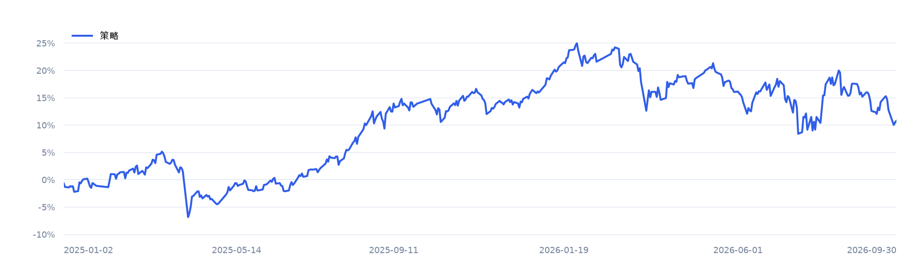

# 经典质量因子 · 10亿100只 · 中文回测报告

2025-01-02 至 2026-09-30，共 **424 个交易日**。初始资金 **1,000,000,000.00 元**。

## 1. 先看账户赚亏

| 观察项目 | 实际结果 |
|---|---:|
| 投资赚亏 | 107,818,898.47 元 |
| 区间收益率 | 10.78% |
| 最大回撤 | 13.26% |
| 平均实际仓位 | 73.85% |
| 目标仓位 | 95.00% |
| 首笔成交 | 2025-01-02 |

“投资赚亏”是期末净资产减去初始资金和净入金，已经扣除已计交易成本。“最大回撤”表示资金从此前最高点回落的最大比例。目标仓位表示策略希望投入的比例，实际仓位由成交和账户规则形成。

## 2. 实际退出记录

**退出方式：末日按规则退出。** 按逐日可获知信息执行所选末日规则。

期末退出于 **2026-09-29** 触发，计划退出 **100 只**。

| 退出项目 | 实际记录 |
|---|---:|
| 期末实际卖出 | 2026-09-30，100 只，成交额 47,513.01 万元 |
| 期末完成清仓 | 27 只 |
| 期末保留持仓 | 73 只，市值 45,115.37 万元，占净资产 40.72% |
| 主要剩余原因 | 共享容量或合法数量限制 73 只 |

期内另有 3 只证券更早触发规则退出，其中 3 只已清仓。以上按规则退出计划汇总实际成交。[逐证券实际退出摘要](exit_summary.csv)记录触发、实际卖出、费用及剩余持仓；[原始退出记录](exits.parquet)保留逐日过程。剩余持仓按期末有效行情计入净资产。

## 3. 资金曲线

蓝线表示本次策略。收益曲线按份额计量，入出金另行记录。聚合曲线见 [账户净值 CSV](equity.csv)。

## 4. 期末资金与执行结果

| 账户项目 | 金额或数量 |
|---|---:|
| 期末净资产 | 1,107,818,898.47 元 |
| 期末现金 | 656,665,155.13 元 |
| 期末股票及等价持仓市值 | 451,153,743.34 元 |
| 应收款 | 0.00 元 |
| 待结算权益 | 0.00 元 |
| 负债 | 0.00 元 |
| 陈旧估值对应市值 | 0.00 元 |
| 期末持仓证券数 | 73 |
| 成交笔数 | 8,914 |
| 记录容量限制的订单数 | 5,227 |
| 因容量到期的委托余量累计折合 | 17,783,177,885.61 元 |

容量受限金额按各次开盘价折算，包含买卖双向及跨日重复尝试；它用于解释执行约束。完整逐笔运行目录中的 `exits.parquet` 保存逐日退出触发、实际卖出进度和剩余数量。

## 5. 交易成本去向

| 项目 | 金额 | 规则 |
|---|---:|---|
| 佣金 | 845,044.34 元 | 单边万分之 1，每单至少 5.00 元 |
| 印花税 | 2,026,092.16 元 | 卖出金额的万分之 5 |
| 过户费 | 84,405.52 元 | 按历史生效费率 |
| 滑点成本 | 4,220,268.14 元 | 成交金额的万分之 5，独立计费 |
| 显式税款 | 0.00 元 | 依注入金额应计，支付与负债分别记账 |
| 显式费用 | 0.00 元 | 依注入的实际金额事件 |
| 合计 | 7,175,810.16 元 | Decimal 逐笔记账 |

## 6. 数据与研究假设

本策略使用质量因子，指标为「归母净利润 TTM / 同期及上年同期平均归母净资产」，优先选择指标高的证券。十因子共同有效股票池内按分数排序，同分时按证券代码升序。每 5 个交易日调仓，最多 100 只，每只目标权重 0.95%；名额不足时保留现金。

行情和累计复权因子来自[课程数据 Release](https://github.com/aslan9/pku_quantllm/releases/tag/data-backtest-20261016)，历史 ST 状态来自 BaoStock 0.9.4 的 query_daily_history_k_AStock 缓存。财务、历史总股本和已实施分红来自东方财富数据接口。总市值按本地原始收盘价乘以当日总股本计算。财务因子使用结构化资产负债表与利润表字段，其中成长采用营业总收入 TOTAL_OPERATE_INCOME。

财务记录以报告期维护各自版本，从 max(REPORT_DATE, NOTICE_DATE, UPDATE_DATE) 日期结束后的下一交易日开始使用。本研究采用当前抓取版本加保守时间推迟的历史版本近似；完整历史修订过程仍需历史时点数据支持。因此本结果采用保守探索性口径；财务信息滞后和共同样本筛选会影响收益。[十因子比较报告第 3 节](../../reports/classic-factors/report.md)列明全部数据源、接口字段、时间范围、抓取记录及溯源边界；[原始请求索引](../../reports/classic-factors/sources.json)保留每项请求的 URL、抓取时间和哈希。

- 当日累计复权因子推定为开盘前生效，使用总收益等价单位；原始价格用于成交和费用。
- 完整日线的当日成交额用于开盘记录有效性核验；高低收价格用于收盘诊断。
- BaoStock 逐日 ST 状态推定在当日开盘前可知；带明确可获知时间的覆盖事件按其时间执行。
- 价格边界为历史规则与复权参考价推算的候选，首次观测与业务上市事实分别记录。
- 容量仅使用决策日已知成交额；日频开盘成交采用方向性封板规则，盘口排队由更细数据扩展。

历史状态覆盖 2,155,920 / 2,155,920 个待选股票日。预热自 2023-01-01 开始，首批决策日为 2024-12-31。计算设备为 mps，资金与费用采用 Decimal 记账。因子快照路径和哈希保存在运行配置中。

## 7. 规则来源与复现

- [2025 年交易日历](https://www.sse.com.cn/disclosure/dealinstruc/closed/c/c_20241223_10767110.shtml)
- [2026 年国庆休市](https://www.sse.com.cn/disclosure/announcement/general/c/c_20260915_10832273.shtml)
- [2026-07-06 主板风险警示涨跌幅调整](https://www.sse.com.cn/aboutus/mediacenter/hotandd/c/c_20260424_10816474.shtml)
- [证券交易印花税减半](https://shanxi.chinatax.gov.cn/web/detail/sx-11400-545-1780448)
- [零股卖出规则](https://www.sse.com.cn/lawandrules/guide/stock/jyglywznylc/tz/c/c_20230209_5716007.shtml)
- [上交所股票投资费用说明与过户费](https://one.sse.com.cn/onething/gptz/)
- [中国结算历史收费调整记录](https://m.chinaclear.cn/zdjs/dsj/about_dsj.shtml)

- 运行编号：`classic-quality-af58780c97`
- 运行配置：[config.json](config.json)
- 精确金额与指标：[summary.json](summary.json)
- 设备、依赖与源码哈希：[manifest.json](manifest.json)
- 数据指纹：`343d1e94eec2c4e7619fec08695705e022a9a590a8871ef4007fdd0561fd2f49`
- 状态指纹：`836ff2bb30f416ea1d05277ced05819dd565629f3d6f3ea0ca223c84a97405a4`

本地运行保留订单、成交、借贷分录、持仓、费用、事件、逐日选股与源码快照，可通过工作台或 CLI 追溯单笔成交。

